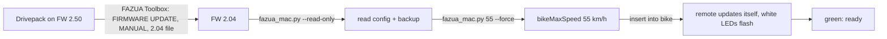

# FazuaUnlocker on macOS

Fork of [quezzas/FazuaUnlocker](https://github.com/quezzas/FazuaUnlocker) (MIT) with one added file: `fazua_mac.py`. It swaps the Win32 HID transport for [hidapi](https://pypi.org/project/hidapi/), so the tool runs on macOS (tested on Apple Silicon, macOS 15.5). The protocol, CRC and write/verify flow are untouched and imported from `fazua_unlock.py`.

Tested on 2026-10-16 on a Canyon Roadlite:ON AL 7.0 (2020), FAZUA RIDE 50 EVATION:

| | Before | After |
|---|---|---|
| Drivepack firmware | 2.50 | 2.04 |
| bikeMaxSpeed | 24.98 km/h (raw 694) | 55.01 km/h (raw 1528) |
| Wheel length | 2121 mm | 2121 mm |



## Steps

1. Take the Drivepack out of the bike, battery switched on inside it. Open the USB cap (Torx T10) and connect a mini-USB data cable. Lay it flat.
2. Get firmware 2.04 (original FAZUA file, archived copy, SHA-256 checked):
   ```sh
   ./get_firmware_2.04.sh
   ```
3. FAZUA Toolbox: FIRMWARE UPDATE, UPDATE NOW, **Manual** (not Online), pick `evation_Software_2.04.bin`, START. Do not move the Drivepack. Check: `system_profiler SPUSBDataType | grep evation` shows `evation v2.04`.
4. Quit the Toolbox (it holds the USB device), then:
   ```sh
   python3 -m venv .venv && .venv/bin/pip install -r requirements-mac.txt
   .venv/bin/python fazua_mac.py --read-only        # read, no writes
   .venv/bin/python fazua_mac.py 55 --dry-run       # build packet, send nothing
   .venv/bin/python fazua_mac.py 55 --force         # write and verify
   ```
5. Unplug, screw the USB cap back on (1 to 1.5 Nm, the Drivepack is not waterproof without it), insert into the bike. The remote may flash white while it updates itself. Do not touch it. When it shows green it is ready.

Back to stock: `.venv/bin/python fazua_mac.py 25 --force`.

## Warning

Above 25 km/h the bike is no longer a pedelec. In Germany it is then only allowed on private property, not on public roads (StVZO, and possibly § 21 StVG and § 6 PflVG). Warranty and insurance can be gone. Flashing can brick the Drivepack if it is interrupted. Your own risk.
